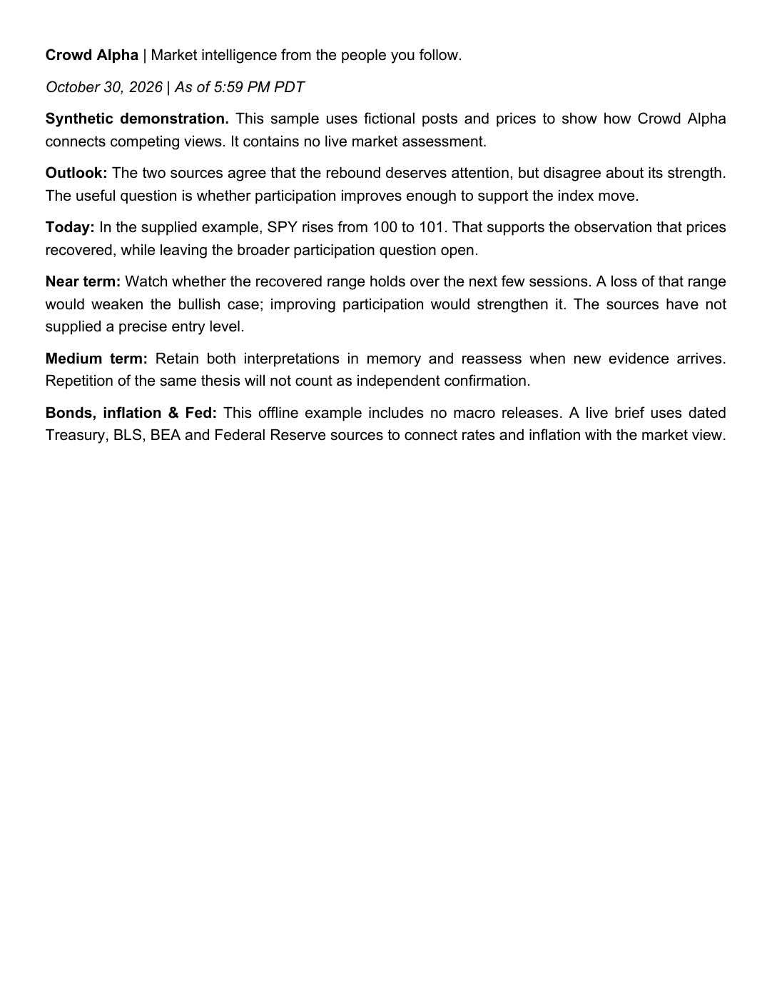

# Crowd Alpha

**Market intelligence from the people you follow.**

Useful market commentary is scattered across X threads, Discord conversations and charts. Crowd Alpha connects the accounts you choose with price data and macro releases, builds a concise daily view, and remembers the questions and competing theses worth following.

Run it with Codex or Claude Code on macOS. Bring your own X API access and Alpaca market-data credentials; connect TradingView and Discord when you want to research an idea further.


*Actual PDF output from the included synthetic demo. The sources, prices and assessment in this example are fictional.*

## From scattered posts to a market view

- **Read across sources.** Collect posts from your chosen X accounts, retrieve referenced context, and select relevant still-image charts for analysis.
- **Check the evidence.** Compare commentary with Alpaca stock/ETF prices and dated Treasury, inflation and Federal Reserve releases. Every brief has a local evidence archive.
- **Keep context.** Carry forward source notes, competing views, conditions and unanswered questions. Resume the conversation in Codex or Claude Code with the saved memory.
- **Run consistently.** Cache completed retrievals and model stages, reserve X spending before requests, and recover missing daily reports without overwriting newer memory.

## Set it up with your agent

Give Codex or Claude Code the repository URL and this instruction:

> Set up Crowd Alpha on my Mac. Read AGENTS.md and follow docs/setup.md. Ask me for my source accounts, engine, spending limit and schedule, help me configure credentials locally, and verify the installation before enabling scheduled collection.

The setup agent handles installation and configuration. You sign in to your chosen engine and enter secrets in your terminal. Your account roster, credentials and generated research stay out of Git.

To try the offline demo yourself:

```sh
python3 -m venv .venv
.venv/bin/python -m pip install -r requirements.txt
.venv/bin/python crowd_alpha.py --demo
```

The demo replays synthetic inputs and a supplied example synthesis through the real PDF, evidence-archive and memory code. It makes no network or model calls. Generated files appear under `.local/demos/`.

## Research interactively

Open this repository in your agent and ask a question about the saved market view. The agent can retrieve fresh X posts when you authorize a lookup. Optional TradingView and Discord connections let it compare charts and discussion with the saved evidence; those integrations are used interactively and are not required by the daily job.

[Setup and commands](docs/setup.md) · [Optional integrations](docs/integrations.md) · [How it works](docs/design.md)

## Development

Python 3.11+ on macOS. Install `requirements-dev.txt`, then run:

```sh
.venv/bin/python tests/run_tests.py
.venv/bin/python crowd_alpha.py --self-check
```

MIT licensed. This is a static release of a personal research workflow built with AI coding tools.
